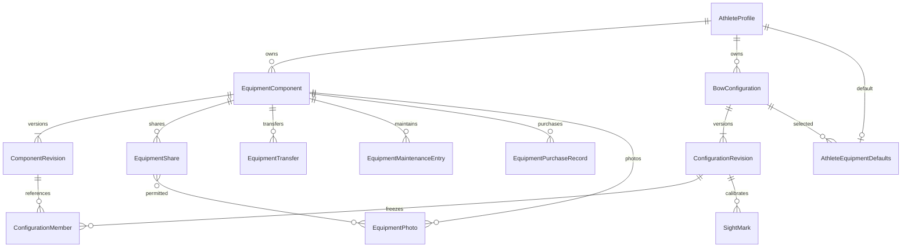

# Advanced equipment implementation record

## M0 baseline (30 October 2026)
Remote main fetched at 0d47839; original clean checkout feature/user-equipment at da1e25b.
New branch codex/advanced-equipment-management starts at remote main. Main lacks the
revision/sight-mark implementation assumed by the specification. Reused da1e25b and
its athlete-discipline migration prerequisite 3a44018, without the training module.
Original main: 102 Django tests passed, 3 skipped (SQLite, from app directory).
Running discovery from the repository root finds zero tests and is not validation.

Architecture: Django views/forms -> equipment services -> scoring models. Authorization
uses accounts.permissions.can per operation, never self-selected roles. Existing
Equipment, revisions, arrows and sight marks remain authoritative legacy records.
No automatic inference of legacy components; basic equipment remains usable.

Schema decisions: stable components have one owner and append-only typed snapshots.
Configurations reference exact component revisions through normalized membership.
All writes lock the athlete and target rows, check current grants and optimistic
revision tokens, then append audit data in the same transaction. PostgreSQL row-lock
verification is required before release; SQLite cannot establish concurrency safety.
Do not run shared database migrations or deploy from this branch without review.
Test database creation/migration is isolated to disposable test databases.

## M1/M2
Component specs use schema version 1, documented in the workspace field reference
and `scoring/component_specs.py`. Numeric names carry units; optional fields are not
inferred. Configuration membership uses immutable revision foreign keys. Component
updates require explicit configuration adoption; rename is a material version change.
All physical fit remains unverified and requires acknowledgement; declared discipline
conflicts are rejected. Interface mismatch is an acknowledged warning, not fit advice.
Seven statuses apply to physical components; only active components are selectable.
Legacy equipment retains its existing active/archive behavior.

## Sharing connection policy
Connected means existing athletes with a common unrevoked guardian (view/edit), or
an athlete whose account has an explicit unrevoked coach relationship to the other.
A common self-selected coach role is insufficient. UUID entry never discovers a
recipient inventory. Each recipient must approve through its own edit-profile grant.
Live relationship and share checks apply to future selections. Shared payloads exclude
private notes and serial references. Transfers append an ownership revision, revoke
all prior shares and preserve original revisions and configuration snapshots.

## Private media, purchases and maintenance
Install requirements.txt. Local development: EQUIPMENT_MEDIA_BACKEND=local and
EQUIPMENT_MEDIA_ROOT to a private directory outside static/media hosting. Production:
EQUIPMENT_MEDIA_BACKEND=azure, EQUIPMENT_AZURE_CONNECTION_STRING from environment
secret management and EQUIPMENT_AZURE_CONTAINER naming an existing private container.
No container is created or made public. Storage checks reject public containers.
Every download passes live authorization; keys are never included in HTML payloads.
Receipts currently support photographed JPEG/PNG/WebP images, not PDF or office files.
Uploads accept at most 8 MB / 20 million pixels and re-encode to metadata-free JPEG
bounded to 2400 pixels. Active content formats are rejected. Images are not claimed
virus-scanned; Azure malware scanning can be applied as an operational defense.

Maintenance and purchases are append-only with correction links. Supported ISO
currencies are listed by the purchase form; no currency conversion or default is
inferred. Financial data and receipts require athlete/editing guardian authority,
including historical owner authority following transfers. Shared recipients cannot
read maintenance, purchase records or receipts. Removed images become immediately
inaccessible. Operators must periodically reconcile blob keys to EquipmentPhoto:
retain active keys, remove inactive keys only after the agreed retention interval,
and remove unreferenced keys older than 24 hours (never delete fresh uploads).
Failed metadata writes attempt immediate blob cleanup. Do not publicly serve the
local private directory. Test storage uses temporary directories only.

## Schema overview

Existing Equipment/EquipmentRevision/PhysicalArrow remain unchanged identities.
ScoringSession.equipment stores values, not live configuration dereferences. Photos
are never copied into scoring snapshots. New scoring contexts cannot change equipment
after their first arrow, and first-arrow recording rechecks current availability.
The dashboard uses accessible section links, native forms and responsive wrapping.
Activity pagination uses stable (time, primary key) order; per-component activity
filters only the viewing athlete's audit events, including historical transfer events.
Shared recipients receive only selected photo access; future uploads are not inherited.
Comparisons use completed, valid, undeleted results, verification requirements, exact
snapshot associations and separate training/competition contexts. At least two sessions
are required before displaying a group mean. This threshold is a display convention,
not a statistical significance claim. Dates use the athlete timezone.

## Migration review and rollout
Review scoring migrations 0002 through 0008 and accounts 0005. 0002/0005 are existing
prerequisite migrations reused with their original identities. 0003/0004/0006/0007
create additive tables; 0005 adds an optional configuration sight-mark reference and
makes the legacy bow reference nullable; 0008 adds scoped photo sharing and checks.
No scorecard or biomechanics tables are changed. No deployment pipeline was triggered.
No application/shared database has been migrated by this work; tests migrate only
isolated disposable databases.

Before rollout, back up database and private blobs, review migration SQL and assess
locks against actual row counts; configure private storage and test authorized reads.
Deploy only after release approval. Existing startup can automatically migrate:
**do not deploy this branch just to preview it**. Keep basic equipment available during
transition. Existing bows are not auto-expanded into invented components. Users create
named configurations explicitly and can leave their default unset.

Prefer code rollback with schema retained after new equipment data exists. Reversing
additive migrations drops new records and may invalidate new sight marks: export a
backup and obtain explicit approval before schema rollback. Never rewrite historical
scoring snapshots to make an older release understand new equipment; legacy fallbacks
must remain. Media removal is logical first; retention cleanup is an operator task.

## Verification commands (run from app)
- ../.venv/Scripts/python.exe manage.py check --settings=config.test_settings
- ../.venv/Scripts/python.exe manage.py makemigrations --check --dry-run --settings=config.test_settings
- ../.venv/Scripts/python.exe manage.py test --settings=config.test_settings --noinput
- ../.venv/Scripts/python.exe manage.py test --settings=config.equipment_test_settings --noinput

PostgreSQL test settings are fixed to a disposable localhost:55439 instance and never
inherit production connection configuration. Start a fresh postgres:17-bookworm
container named goldpath-equipment-phase2-tests, with no existing volumes, database/user
equipment_test and local test password equipment_test_local_only. Stop the container
afterward; Docker --rm removes the disposable container. These credentials are only
for the dedicated local test instance, never deployment configuration.

## Manual release checks and limitations
- Inspect 375px/mobile and desktop layout, keyboard focus, error announcements and screen-reader labels.
- Confirm default/preferred-arrow selection and a first-arrow concurrent request in two browsers.
- Review junior/guardian invitations, revoked shares, accepted transfers and historical purchases.
- Exercise Azure private-container rejection, upload/download failures, retention reconciliation and key-safe logging in staging with non-production data.
- Validate backup/restore and migration duration on a realistically sized sanitized database copy.
- Receipts currently accept images only; ISO currencies are the supported form subset.
- No public galleries, manufacturer fit certification, import/export, equipment segments or automatic tuning advice.
- No live Azure storage or browser/screen-reader visual QA has been claimed.

## Recorded verification (30 October 2026)
Main baseline: 102 tests, 3 skipped. Reused prerequisites: 116 tests, 3 skipped.
Final full suite: 161 tests passed on PostgreSQL 17 (no skips); SQLite: 161 tests
passed with 4 PostgreSQL-only concurrency tests skipped. Django check: no issues.
makemigrations --check --dry-run: no changes. git diff --check: clean.
The PostgreSQL-only nullable join lock failure found during development was corrected
by locking the photo row explicitly; the full PostgreSQL suite was rerun successfully.
Migration generation succeeded; the optional formatter subprocess emitted Windows
WinError 623, so generated migrations were inspected without claiming formatter success.
No Azure round-trip, deployment, production/shared migration or browser accessibility
certification was performed. Manual release checks above remain required.

## PR-ready summary
Advanced equipment extends the existing Django scoring system with stable, versioned
components, named frozen configurations/defaults, first-arrow equipment locks,
version-specific sight marks, explicitly approved sharing/accepted transfers, private
media, maintenance/purchase histories, and permission-filtered timelines/comparisons.
The branch includes two prerequisite commits absent from remote main: existing equipment
revisions/sight marks and their athlete-discipline migration dependency. Review those
separately from Phase 2. Existing basic equipment and both URLs remain supported.

Review migrations and private storage configuration before applying anything. This is
an implementation for review, not a production release approval. Remaining external
verification is private Azure integration, browser/mobile/screen-reader QA and migration
performance/restore testing with a sanitized deployment-size copy.

## Equipment section pages
The equipment entry point now shows Overview. Each navigation item has a dedicated
`/account/athletes/<uuid>/equipment/<section>/` page (also available under the scoring
route). Forms, filters, validation errors and successful saves stay on that page.
Basic bows appear under Configurations; arrow-set identity and physical arrows are
under Arrow sets. Photos are managed beside Components/Configurations, and receipts
beside Purchases. Purchase pages require the same owner/editing-guardian permission
as purchase records. Unknown sections return 404. Older fragment links redirect to
the corresponding page in browsers; both original equipment entry URLs remain valid.
This layout change requires no database migrations.
